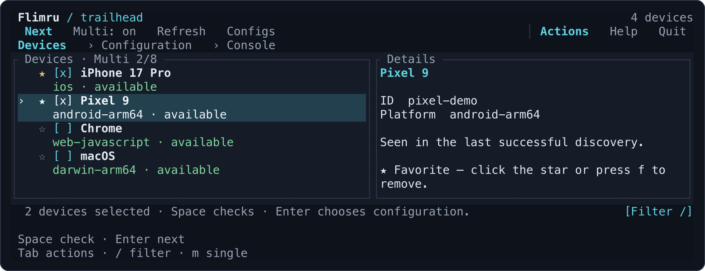

# Flimru

Pick a device, run a Flutter launch configuration, and hot reload from your terminal. Your coding agent can use the same sessions.



## Install

**With an agent:** Copy this prompt into your coding assistant from your Flutter project. The private preview requires GitHub access.

```text
Set up Flimru in this Flutter checkout. On Apple Silicon, download the
darwin-arm64 archive and SHA256SUMS with gh release download v0.1.0 -R CreevekCZ/flimru.
Verify the checksum and install the binary on PATH. Otherwise, clone
CreevekCZ/flimru separately from its v0.1.0 tag if available, or main, and
install with cargo install --locked --path /path/to/flimru.

Use this project's Flutter or FVM SDK, installing it if needed. Keep the
existing .vscode/launch.json, or create a Dart launch config if missing.
Run flimru --check. Register the absolute Flimru path as a local stdio MCP
server named flimru with argument mcp. Add a short project rule to check
existing Flimru sessions first and use Flimru to start and control runs.
Open flimru in a terminal here if possible and verify flimru session list.
Tell me if I need to restart this agent to load the tools.
```

**From source:** Clone [Flimru](https://github.com/CreevekCZ/flimru) and run `cargo install --locked --path .` from that clone. Run `flimru` in your Flutter checkout.


[Usage and shortcuts](docs/usage.md) · [MCP and CLI reference](docs/agents.md) · [MIT](LICENSE)
