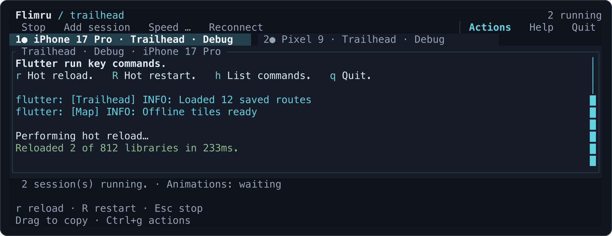

# Flimru

Pick a device, run a Flutter launch configuration, and hot reload from your terminal. Your coding agent can use the same sessions.


## Install

**With an agent:** Paste this prompt into your local coding assistant once.

```text
Install Flimru on my PATH from https://github.com/CreevekCZ/flimru. Verify a
published binary's checksum, or build from main with Cargo.

In my user-level MCP settings, register a stdio server named flimru. Use the
installed binary's absolute path with mcp as its only argument. Add this rule
to my global agent instructions:
For Flutter runs, reuse a matching Flimru session. Use Flimru to start runs,
read logs, and reload, restart, or stop. If MCP is unavailable, use
flimru session from the Flutter checkout.

Check flimru --version and confirm the server is registered. Tell me if I need
to restart the agent.
```

**From source:** Clone [Flimru](https://github.com/CreevekCZ/flimru) and run `cargo install --locked --path .` from that clone.

Open `flimru` and your agent in the Flutter checkout you want to run. The setup works across your projects.



[Usage and shortcuts](docs/usage.md) · [MCP and CLI reference](docs/agents.md) · [MIT](LICENSE)
